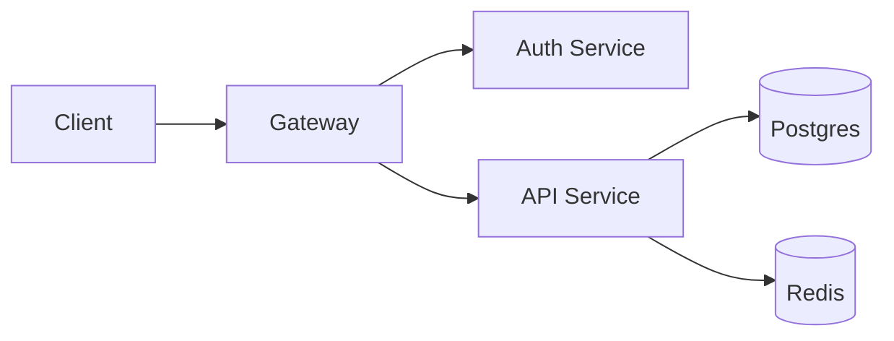
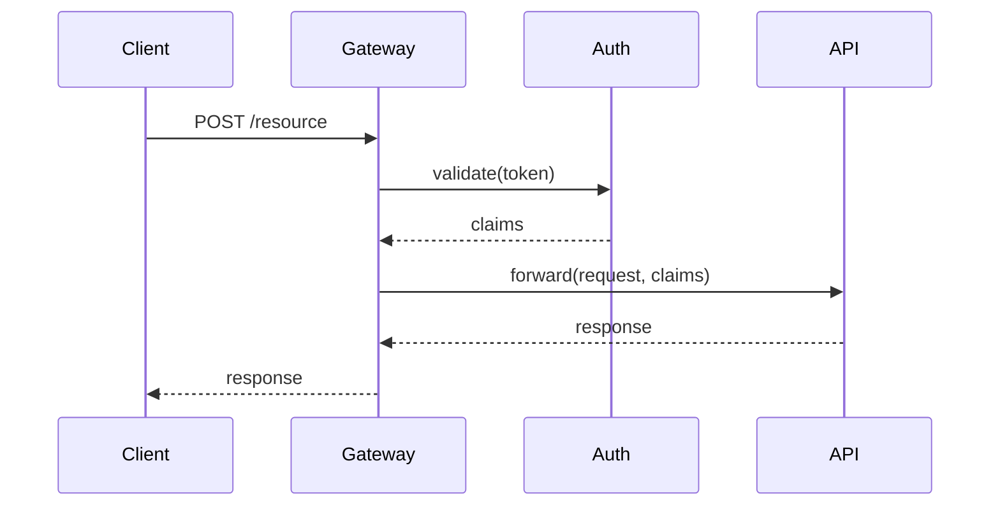
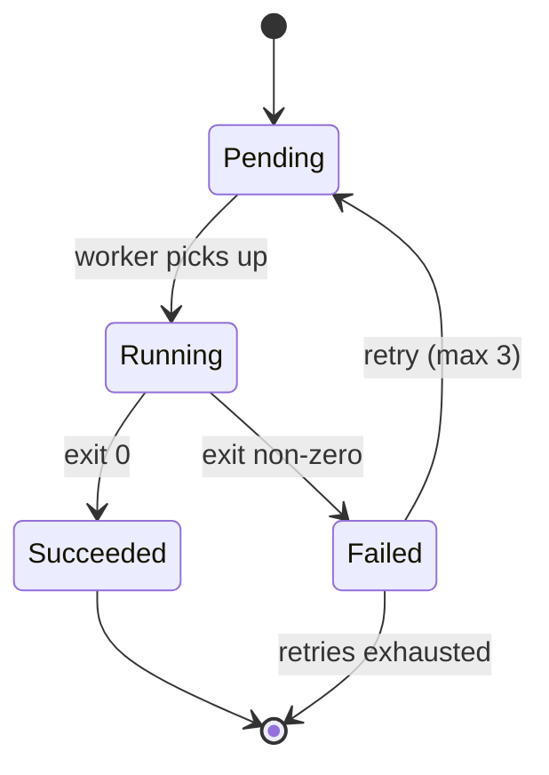
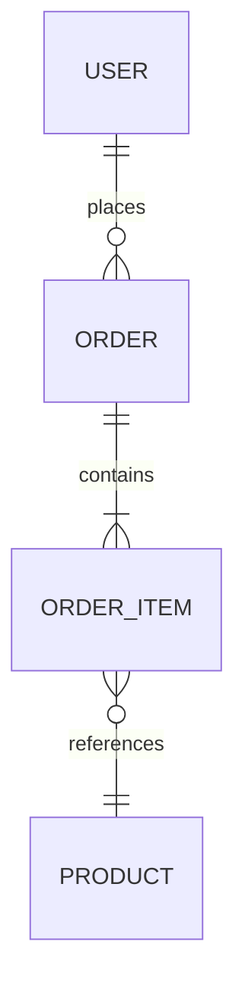

# Mermaid Diagram Guide

Diagrams are expensive for the reader — they require visual parsing, context switching, and often re-reading. Include a diagram only when it carries information that prose or a list cannot carry efficiently.

## When a diagram earns its place

- **Three or more actors exchanging messages in a specific order** → sequence diagram.
- **A state machine with non-trivial transitions** → state diagram.
- **A component graph with more than a couple of edges** → flowchart.
- **A decision tree the reader must navigate** → flowchart.
- **A data model with entity relationships** → ER diagram.

## When to skip the diagram

- The "flow" is linear (A → B → C). A sentence handles this: "The request passes through the rate limiter, then the authenticator, then the handler."
- The diagram would have fewer than four nodes. Prose is faster.
- The diagram restates what a code example already shows.
- The relationships are too numerous to render clearly. Split into multiple focused diagrams or use prose.

## Diagram type selection

### Flowchart — for component diagrams and decision flows

Use for: architecture overviews with a handful of components, branching logic, dependency graphs.



**Tips:**
- `LR` (left-to-right) reads more naturally for most architecture diagrams than `TD` (top-down).
- Use shape hints to convey type: `[(Postgres)]` for databases, `([Queue])` for queues, `[[Service]]` for services.
- Keep labels short. If a label needs explanation, put the explanation in the surrounding prose.

### Sequence diagram — for interactions over time

Use for: API call flows involving multiple services, authentication handshakes, message-passing protocols.



**Tips:**
- Use `-->>` for responses and `->>` for forward messages.
- Include only the actors relevant to the flow being shown. A sequence diagram with seven participants is a sign the flow should be split.

### State diagram — for state machines

Use for: order lifecycles, connection states, job status transitions.



**Tips:**
- Label transitions with the triggering event or condition.
- Show terminal states with `--> [*]`.

### ER diagram — for data models

Use for: schema overviews when the reader needs to see relationships, not field-level details.



**Tips:**
- Use ER diagrams for relationships, not for full schema reference. Full schemas go in a table.
- Cardinality notation: `||--o{` means "one to zero-or-more".

## Formatting

- Always wrap in a ```` ```mermaid ```` fenced code block.
- Place the diagram immediately after the prose that introduces it. Do not make the reader scroll to find what the diagram illustrates.
- Precede the diagram with a single sentence stating what it shows, e.g., "The authentication flow involves three services:"
- Do not number or caption diagrams. The surrounding prose provides context.

## What to avoid

- Diagrams with more than ~10 nodes. Split or rethink.
- Mixing diagram types in a single document unless each adds distinct information.
- Diagrams that duplicate a list. If the diagram only shows A, B, C with no relationships, use a list.
- Decorative use. Every diagram must answer a question the reader would otherwise have to construct from prose.
